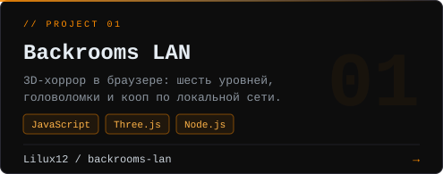
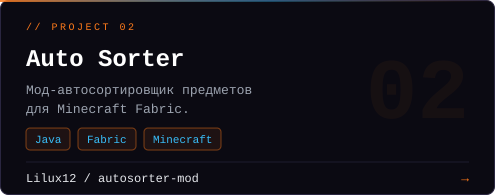
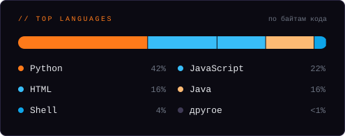

 

<table>
<tr>
<td width="58%" valign="top">

### 👋 Обо мне

Привет! Я **Тёма**, мне **13 лет**. Пишу код примерно с 10 лет
и люблю собирать всё с нуля: от схемы и пайки до интерфейса.

- 🎮 Делаю **[Backrooms LAN](https://github.com/Lilux12/backrooms-lan)** — кооп-хоррор в браузере
- ⛏️ Написал **[Auto Sorter](https://github.com/Lilux12/autosorter-mod)** — мод для Minecraft
- 🔧 Паяю и прошиваю ESP32
- 💬 Открыт к идеям и совместным проектам

</td>
<td width="42%" valign="top">

### ⚡ Быстрые факты

| | |
|---|---|
| 🎂 Возраст | 13 лет |
| 🌍 Откуда | Россия |
| ⌨️ В коде | с 10 лет |
| 🛠️ Делаю | игры, моды, железо |

</td>
</tr>
</table>

## 🎃 Проекты

<table>
<tr>
<td width="50%"></td>
<td width="50%"></td>
</tr>
</table>

## 🛠️ Чем пользуюсь

  

## 📊 Статистика

<table>
<tr>
<td width="50%"></td>
<td width="50%"></td>
</tr>
</table>

 

