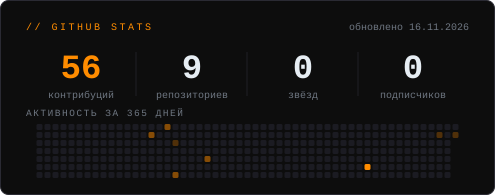

  

  

    

  
  
  

---

## 🧑‍💻 Обо мне

Привет! Я **Тёма** (Lilux) — 12-летний разработчик и мейкер из России.
Пишу код с ~10 лет: от прошивок для ESP32 до браузерных игр и модов.

- 🎮 Делаю **[Backrooms LAN](https://github.com/Lilux12/backrooms-lan)** — кооп-хоррор в браузере на 11 уровней.
- ⛏️ Написал **[Auto Sorter](https://github.com/Lilux12/autosorter-mod)** — мод-автосортировщик для Minecraft Fabric.
- 🧩 Люблю задачи, где всё нужно собрать с нуля: от схемы и пайки до интерфейса.
- 💬 Открыт к идеям, коллаборациям и интересным задачам.

---

## 🛠️ Стек и инструменты

  

    

  
  
  
  
  

---

## 🎃 Проекты

<table>
  <tr>
    <td width="50%">
      
    </td>
    <td width="50%">
      
    </td>
  </tr>
</table>

---

## 📊 GitHub в цифрах

<table>
  <tr>
    <td width="50%">
      
    </td>
    <td width="50%">
      
    </td>
  </tr>
</table>

---

## 🐍 Вклад

  

---

  Понравился какой-то проект? Поставь ⭐ — это лучшая мотивация продолжать.

  

